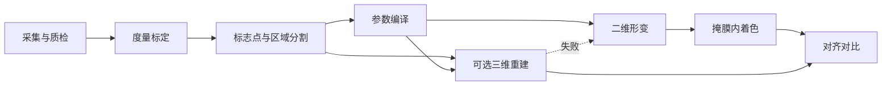

# 术后效果演示：总体技术架构

建议把演示拆成一条以二维几何为主、三维为旁路的流水线。毫米、角度和毫升只由标定和标志点决定；生成模型只在形变区域内补阴影和高光，不能改脸。

最终渲染的细化方案见 `最终渲染方案.md`。

## 1. 采集与质检

用浏览器 `getUserMedia` 拍照，同时允许上传照片和环绕短视频。正脸必收，隆鼻必须另有侧脸，环绕视频可选。

拍完先做质检，不通过就不进入毫米模拟：能检测到一张脸、分辨率足够、不过曝、拉普拉斯方差不明显模糊、正脸偏航和俯仰在小角度内。侧脸不拿来做虹膜标定。环绕视频在浏览器里按固定间隔抽 8 到 12 帧，不在咨询时跑 COLMAP。皮肤纹理少，传统摄影测量又慢，咨询场景里经常对不齐。

## 2. 度量标定

比例尺用 MediaPipe Face Landmarker 的虹膜点。虹膜横径按 11.7 mm 把像素换成毫米。操作者也可以改填内眦间距，作为第二套比例。两套结果差得过多时，标成未标定：滑块还能动，但界面不显示绝对毫米。

正脸比例不能直接套到侧脸。侧脸隆鼻要么沿用同一次正脸求出的毫米/像素，要么在侧脸上手工确认鼻根、鼻背、鼻尖、鼻底。没有侧脸时不生成隆鼻。

## 3. 标志点与区域分割

交互预览用 MediaPipe Face Landmarker 的 FaceMesh-V2：478 个三维点，可在浏览器里用 WebAssembly 或 GPU 跑，Apache 许可适合内网产品。Google 自己的评测里，它的眼间距归一化误差约 2.62%，接近人工标注的 2.56%。它适合正脸的眼、唇和口角。

InsightFace 不做主网格。它强在检测和识别，回归点不够密，撑不起褶皱和红唇边界。

侧脸姿态不要只信 MediaPipe。临床对比里，大角度时它的头部姿态误差大约 11° 到 14°，3DDFA-V2 大约能压到 5° 左右。侧脸只用 3DDFA-V2 辅助判断朝向；鼻背毫米仍以手工确认的五个点为准。

区域掩膜用 BiSeNet（ResNet-18 ONNX，CelebAMask-HQ）。它能分出眼、鼻、上下唇和皮肤，模型大约 43 MB，CPU 也能跑。掩膜用来锁住形变和着色范围。AGRNet 一类在鼻、眼、唇上的 F1 略高，但更重，第一版不必上。

## 4. 参数编译

这一层是纯函数，不调用生成模型。档位只编译成需求里的目标：

- 双眼皮：设计高度 6 / 7 / 8 mm，再映射到不超过约 4 mm 的睁眼可见宽度；形态只有开扇或平行。
- 隆鼻：鼻背 +2 / +3.5 / +5 mm，Goode 指数收到约 0.60，鼻唇角收到约 95–100°，鼻翼外展减少 2–4 mm。
- 丰唇：双唇合计 0.8 或 1.2 mL，上:下增量约 1:1.6，前突固定约 +1 mm，不随容量继续加。
- 嘴角上扬：注射约 +2°；手术按外侧支 1 / 3 / 5 mm 对应约 +3° / +5° / +7°。两套角度不混用。

## 5. 二维几何形变

鼻、唇、口角用刚性移动最小二乘（Schaefer 的 Moving Least Squares，rigid MLS）。控制点在掩膜内移动，掩膜外钉死。它按局部刚性插值，比薄板样条（TPS）更少把皮肤拉斜；TPS 是全局解，一块唇的位移会牵动较远的脸。滑块拖动时在粗网格上算，松手后再算细网格。

双眼皮不用整眼形变。沿上睑缘上方画褶皱：平行型宽度均匀，开扇型向内收窄。只在窄带里加阴影和高光。若把眼睑网格拉开，睑裂长度会跟着变，这和需求相反。

形变后的图必须与原图像素对齐，区域外保持原图。

## 6. 掩膜内着色

第一版用程序化着色，质量稳定且守得住毫米：双眼皮一条暗褶加褶下浅带；鼻背沿形变后的法向加一条高光；红唇只保留原纹理，沿湿润线加很弱的高光。接缝用泊松融合（OpenCV `seamlessClone`）收进掩膜。

不要用无约束的扩散模型当几何引擎。IC-Light、DiFaReli++ 和通用图像编辑会改身份、改光照，也不会遵守 1 mm 或 7°。若以后要补皮肤质感，只能在已经形变好的图上做低强度、掩膜内修补，几何仍以第 5 步为准。

## 7. 可选三维

三维失败就退回第 5 步，不挡住咨询。

第一版三维只用 MediaPipe 自带的 z，在 Three.js 里转一圈，并把同一组位移加到对应顶点上。它不度量，只说明参数作用在同一张脸上。许可干净，笔记本就能跑。

环绕视频若要真几何，抽帧后用 VGGT 一次前向推出相机、深度和点图。它比 DUSt3R / MASt3R 少一轮两两配准，短视频上更合适。点图只保留脸部，再渲染正脸和侧脸。这项要 GPU，皮肤反光时仍会失败，失败即丢弃。

DECA、EMOCA、MICA、SMIRK 都能给出可动画的 FLAME 头模，SMIRK 的表情更像原片。旧版 FLAME 以及这些实现的许可是非商业研究。诊所内网产品不要直接打包。FLAME 2023 Open 是 CC-BY-4.0，可以商用，但现成的 DECA / EMOCA 权重并不因此变成可商用。要走这条路，先单独做许可，不放进第一版。

## 8. 展示与留存

正脸、侧脸并排，原图和模拟图对齐后拖动对比。结果上固定写「模拟效果，非医疗建议，不作为手术承诺」，并回执本次档位和是否已标定。未标定不显示毫米；没有侧脸不给出隆鼻结果。

会话只留在诊所内部：原图、参数、结果、操作者。不做公开链接。

## 9. 应用分层

前端用 React、TypeScript 和 Vite。步骤页、档位卡片和对比滑块都是常规界面，TypeScript 能把三档参数收成类型。像素计算放在 Web Worker 的 OffscreenCanvas 里，不放进 React 渲染。Three.js 只负责可选三维视窗，不负责二维形变。

重模型放在内网的 Python 服务上：BiSeNet ONNX、侧脸 3DDFA-V2、可选的 VGGT。浏览器只跑 MediaPipe 和 MLS，滑块可以即时预览。这样照片默认不必出诊所；服务不可用时，二维预览仍然能做。
